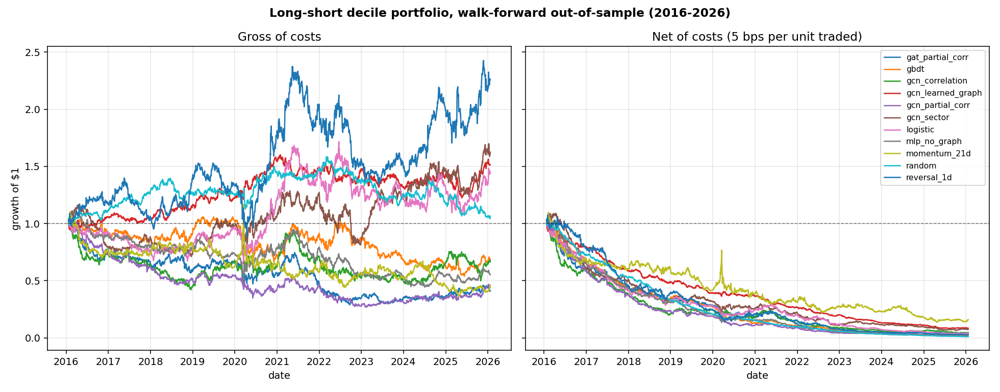
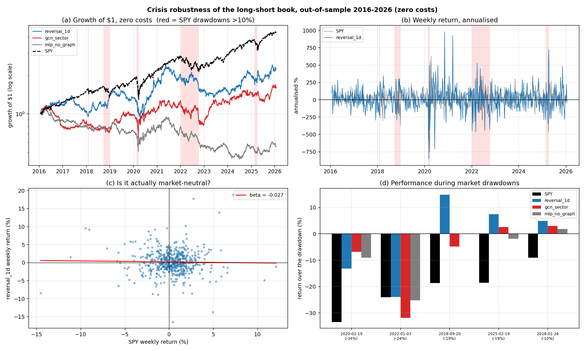

# MarketGraph — do graph neural networks predict relative stock performance?

Modelling 115 US large caps as a **dynamic graph** — nodes are stocks, edges encode
sector membership and rolling return correlation — and testing whether message passing
between related stocks predicts next-day cross-sectional performance better than
modelling each stock in isolation.

Evaluated over **10 years of walk-forward out-of-sample data** (2016–2026) against
non-graph controls, with transaction costs.

---

## Headline result

**The graph did not help, and a one-line heuristic beat every neural model.**

The strongest signal found was short-term reversal — "yesterday's biggest loser tends
to beat the median tomorrow" — at a rank IC of **0.0138** (t = 3.09). The best graph
model reached **0.0047** (t = 1.13), statistically indistinguishable from zero. Its
own non-graph control, an MLP with identical capacity and training, reached 0.0028;
the ~0.002 gap between them is well inside noise.

The edge is also too small to trade. **At zero transaction cost** the best long-short
Sharpe is **0.46** — less than a passive index, for far more risk. Realistic costs for
this universe (~1 bp) cut that to **0.10**; at 2 bps it turns negative.

This is a negative result, reported as one. The value of the project is the
methodology: the leakage controls, the ablation design, and a cost model honest enough
to overturn a result that looks profitable gross.

---

## Results

### Predictive accuracy, pooled out-of-sample 2016–2026 (2,514 trading days)

| Model | Graph | Rank IC | IC t-stat | Accuracy | Precision@10 |
|---|---|---|---|---|---|
| **reversal_1d** | — | **0.0138** | **3.09** | 0.5049 | 0.5070 |
| gbdt | — | 0.0081 | 2.10 | 0.5041 | 0.4972 |
| logistic | — | 0.0061 | 1.40 | 0.5021 | 0.5063 |
| gcn_sector | sector | 0.0047 | 1.13 | 0.5028 | 0.4913 |
| mlp_no_graph *(control)* | none | 0.0028 | 0.78 | 0.5013 | 0.4973 |
| gcn_learned_graph | learned | 0.0018 | 0.95 | 0.5000 | 0.4989 |
| random | — | −0.0007 | −0.40 | 0.4996 | 0.4957 |
| gcn_partial_corr | partial corr | −0.0006 | −0.12 | 0.4993 | 0.4867 |
| gat_partial_corr | partial corr | −0.0065 | −1.17 | 0.4983 | 0.4919 |
| gcn_correlation | correlation | −0.0067 | −1.37 | 0.4975 | 0.4887 |
| momentum_21d | — | −0.0076 | −1.63 | 0.4981 | 0.4899 |

Neural results average 3 seeds. `random` landing at IC ≈ 0.000 confirms the scorer
itself is unbiased.

**Accuracy is nearly useless here** and is shown only because people expect it: the
label is a median split, so chance is exactly 50% and the whole range of outcomes
spans 49.8%–50.5%. Rank IC — the per-day Spearman correlation between predicted and
realised ordering — is the metric to read, and the t-statistic matters more than the
mean, because an edge that flips sign daily is worth nothing.

### Long-short backtest, daily rebalance

Long the top decile, short the bottom, equal-weighted, dollar-neutral.

| Model | Gross CAGR | Net CAGR | Gross Sharpe | Net Sharpe | Daily turnover | Break-even cost |
|---|---|---|---|---|---|---|
| reversal_1d | +8.5% | **−29.7%** | 0.46 | −1.36 | 345% | 1.27 bps |
| gcn_sector | +5.0% | −22.8% | 0.33 | −1.10 | 244% | 1.16 bps |
| gcn_learned_graph | +4.2% | −21.9% | 0.44 | −2.25 | 229% | 0.82 bps |
| logistic | +3.7% | −27.5% | 0.27 | −1.26 | 284% | 0.89 bps |
| random | +0.4% | −36.3% | 0.09 | −4.03 | 361% | 0.11 bps |



The two panels share a y-axis, and the collapse between them **is** the finding. The
break-even column states the execution quality each signal would need, independently of
the cost assumed.

### How much does that depend on the cost assumption?

The 5 bps headline is deliberately conservative. Measuring the floor instead: a
one-cent spread is the minimum tick, and you cross about half of it, which across this
universe is a **median of 0.23 bps** and a **mean of 0.39 bps**. The same penny costs
very different amounts depending on share price — 0.23 bps on a $215 stock, but
**3.56 bps on Ford at $14**.

Net Sharpe across the range (`scripts/cost_sensitivity.py`):

| Model | 0 bps | 0.5 bps | 1 bps | 2 bps | 5 bps | Break-even |
|---|---|---|---|---|---|---|
| reversal_1d | 0.46 | 0.28 | 0.10 | −0.27 | −1.36 | 1.27 bps |
| gcn_sector | 0.33 | 0.19 | 0.05 | −0.24 | −1.10 | 1.16 bps |
| logistic | 0.27 | 0.12 | −0.03 | −0.34 | −1.26 | 0.89 bps |
| gbdt | −0.08 | −0.25 | −0.43 | −0.78 | −1.82 | −0.23 bps |

**This matters less than it looks.** The strategy is not viable at 5 bps *or* at 1 bp,
because the gross Sharpe of 0.46 was never good enough to survive any friction. Costs
are the proximate cause of failure; the weak signal is the real one. Even 1 bp stays
optimistic — the one-cent tick is a floor, spreads widen in stress and around the open
and close (exactly when a daily strategy trades), and borrow fees and market impact are
not modelled at all.

---

### Crisis robustness — where the strategy is actually interesting

Annualised return over a decade hides the property a dollar-neutral book is supposed to
have. Run at zero cost, so the question is whether the *signal* holds across regimes
rather than whether it is tradable.



**It is genuinely market-neutral.** Beta to SPY is −0.03, weekly correlation −0.02.
That is not automatic — the non-graph control `mlp_no_graph` leaked a beta of +0.11.

**It makes money in the market's worst weeks.** In SPY's worst decile of weeks, SPY
annualises to −211% while `reversal_1d` returns **+37.8%** and `gcn_sector` **+21.1%**.

**But only in sharp crashes, not slow bear markets.** Peak-to-trough over the five SPY
drawdowns deeper than 10%, detected from the data rather than hardcoded:

| Drawdown | SPY | reversal_1d | gcn_sector |
|---|---|---|---|
| Feb 2018 (−9%) | −9.1% | **+5.0%** | +3.0% |
| Q4 2018 (−19%) | −18.7% | **+14.8%** | −4.8% |
| COVID (−33%) | −33.4% | −13.2% | −6.8% |
| Feb–Apr 2025 (−19%) | −18.6% | **+7.4%** | +2.6% |
| **2022 bear (−24%)** | −24.1% | **−23.9%** | **−31.9%** |

The 2022 failure is explicable rather than random. Reversal profits from panic: sharp
crashes are overreactions that snap back. 2022 was a ten-month repricing for rising
rates in which declines *trended*, so the strategy kept betting on bounces that never
came. **Survives crashes, not bear markets.**

**This partially rehabilitates the graph.** `gcn_sector` beat its own control on
market-neutrality (−0.04 vs +0.11 beta) and in stress weeks (+21.1% vs −10.0%). The
graph did not improve average rank IC, but it produced a better-behaved portfolio — a
result the headline IC table hides, and the strongest case in this repo for message
passing being worth anything.

## The question, precisely

For each stock *i* on each day *t*, predict whether its next-day return beats the
**cross-sectional median** of all 115 stocks:

```
label[i, t] = 1  if  ret[i, t→t+1] > median_j( ret[j, t→t+1] )
```

Predicting relative rank rather than absolute direction is deliberate:

- **Balanced by construction.** ~50% of the universe beats the median every day, so a
  constant predictor cannot score above chance. An "is it up?" label is ~53/47 because
  markets drift upward, which lets a model look skilled by learning market direction.
- **Market-neutral.** Class balance stayed at 49.57% in the 2021 bull year and the 2022
  bear year while mean daily returns swung from +12 bps to −3 bps.
- **Directly tradable.** Long the predicted-above-median names, short the rest — the
  label *is* the strategy.

---

## Why the evaluation should be believed

Most published "GNN for stock prediction" work reports strong accuracy without a
non-graph control or a cost model. The controls here are the point of the repo.

**1. The ablation isolates the graph.** `mlp_no_graph` shares its capacity, optimiser,
loss, feature set and training loop with `gcn_*` — the only difference is whether
information crosses between stocks. Any gap is attributable to the graph and nothing
else.

**2. Leakage is pinned by behavioural tests, not comments.** 29 tests, three of which
carry the argument:

- `test_label_ignores_prices_beyond_next_day` — multiplies every price from *t+2*
  onward by 3; labels at *t* must be bit-identical.
- `test_features_ignore_the_future` — rewrites all prices and volumes after *t*;
  features at *t* must be bit-identical.
- `test_snapshots_ignore_future_returns` — rewrites returns after a date; correlation
  graphs applied before it must be unchanged.

**3. Walk-forward with an embargo.** 10 folds: train 5 years, validate 6 months, test
12 months, roll forward a year. A 5-day gap separates the blocks — the last training
day's label describes the *next* day's return, so a zero gap leaks it.

**4. Splits and adjustments are verified before modelling.** `validate_data.py` checks
that known splits (NVDA 10:1, AAPL 4:1, …) show no artificial jump — unadjusted, a 10:1
split reads as a −90% crash and teaches the model a crash that never happened.

**5. Seed variance is averaged, not cherry-picked.** Every neural result averages 3
seeds. On data this noisy a single seed is close to a coin flip about which model wins.

---

## Method

**Data** — 115 US large caps + SPY, daily OHLCV from Yahoo Finance, 2010–2026 (481k
rows). ADRs excluded: their home markets close before the US open, so their US prices
echo moves that already happened, which leaks into a next-day target. Dual-class
duplicates (GOOG/GOOGL, BRK.A/BRK.B) excluded: they correlate ~0.99 and would dominate
a correlation graph with an edge that teaches nothing.

**Features** — 10 per stock per day: 4 momentum horizons, realised volatility and a
volatility-regime ratio, 2 moving-average distances, a volume z-score, and rolling beta
to SPY. Each is **standardised across stocks within a day**, not across time within a
stock — this mirrors the label, neutralises regime shifts (a 2% move was ordinary in
March 2020 and extreme in 2017), and strips out the market factor.

**Graphs** — three variants, rebuilt monthly from a 126-day trailing window, sparsified
to each node's top-8 neighbours:

| Graph | Construction | Within-sector edges |
|---|---|---|
| `sector` | same GICS sector | 100% |
| `correlation` | rolling return correlation | 36.0% |
| `partial_corr` | correlation after removing the market factor | 40.2% |

Partial correlation exists because unrelated large caps still correlate ~0.18 purely
through the index, so a plain correlation graph largely encodes "is a stock". Removing
the common factor makes the graph measurably more sector-aligned (36.0% → 40.2%).

**Models** — written from scratch in plain PyTorch. With 115 nodes the adjacency is a
dense 115×115 matrix, so a graph convolution is literally `A_hat @ (H @ W)`; PyTorch
Geometric would add a fragile dependency and hide the arithmetic for no gain.

- `MLP` — per-node, no message passing. The control.
- `GCN` — `H' = σ(Â H W)`, fixed edge weights.
- `GAT` — multi-head attention learning per-neighbour weights, masked to graph edges.
- `LearnedGCN` — learns the adjacency itself from node embeddings, `A = softmax(relu(E₁E₂ᵀ))`.

---

## Limitations

Stated plainly, because they bound what the result means:

- **Survivorship bias.** The universe is companies large *today*. Firms that were large
  in 2012 and then collapsed are absent, biasing backtests optimistically. Removing it
  needs point-in-time index membership, which is paid data.
- **Ticker continuity.** Yahoo backfills predecessor history into merged tickers —
  `TMUS` carries MetroPCS pre-2013, `LIN` carries Praxair pre-2018, `RTX` carries United
  Technologies pre-2020.
- **Yahoo Finance is unofficial** and has no quality guarantee. That is why
  `validate_data.py` exists, but it cannot substitute for a vendor with point-in-time
  data.
- **Validation windows are short.** 6 months ≈ 127 days makes the validation IC used for
  early stopping noisy, and the gap between validation IC (~0.03–0.05 on early folds)
  and test IC (~0.00) suggests early stopping is partly selecting noise. This is the
  most likely reason the neural models underperform gradient boosting.
- **One horizon, one label.** Only next-day, median-split. Nothing here tests whether
  graphs help at weekly or monthly horizons.
- **Costs are a model, not a fill.** Reported across 0–10 bps rather than at one
  assumed level, because the right number is genuinely uncertain: commission is now
  zero, the measured half-spread floor is ~0.4 bps, but that floor ignores spread
  widening in stress, retail fills being worse than the midpoint under payment for
  order flow, short borrow fees, and market impact.

## What I would do next

1. **Rebalance less often.** The cost analysis points straight here: turnover of 200–350%
   daily is what kills every strategy. A weekly or monthly horizon would cut turnover by
   roughly an order of magnitude, and is the single change most likely to flip the net
   result.
2. **Train on a ranking loss.** The objective is ordering, but the models optimise
   binary cross-entropy, which rewards calibration instead. A listwise loss (ListMLE, or
   a differentiable soft-IC) targets the metric directly.
3. **Widen the validation window** to 12 months to make early stopping less noisy.
4. **Add temporal structure.** Features are a snapshot per day; a GRU or TCN encoder per
   node before message passing would let the model use sequences rather than levels.

---

## Running it

```bash
pip install -r requirements.txt
```

```bash
python scripts/fetch_data.py
```

```bash
python scripts/validate_data.py
```

```bash
python scripts/run_baselines.py
```

```bash
python scripts/run_gnn.py --seeds 3
```

```bash
python scripts/run_backtest.py
```

```bash
python -m pytest tests/ -q
```

The GNN sweep is 180 training runs (6 configs × 10 folds × 3 seeds) and takes ~25
minutes on a laptop CPU. Everything else runs in seconds. Only `fetch_data.py` touches
the network; it caches to Parquet so results stay reproducible.

## Layout

```
marketgraph/
├── data/         universe definition, yfinance ingestion
├── features/     node features, labels, dataset join, walk-forward splits, tensors
├── graphs/       sector / correlation / partial-correlation construction
├── models/       baselines (logistic, GBDT, heuristics) and GNNs (GCN, GAT, learned)
├── train/        training loop with IC-based early stopping
└── eval/         metrics (rank IC, precision@k) and the cost-aware backtest
scripts/          runnable entry points
tests/            29 tests, incl. the three leakage tests above
```

---

*Not investment advice. The backtest is a measurement of a research question, not a
strategy recommendation, and its limitations are listed above.*
